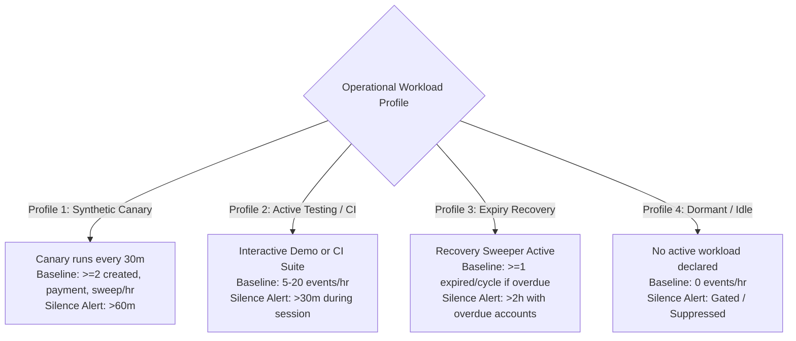
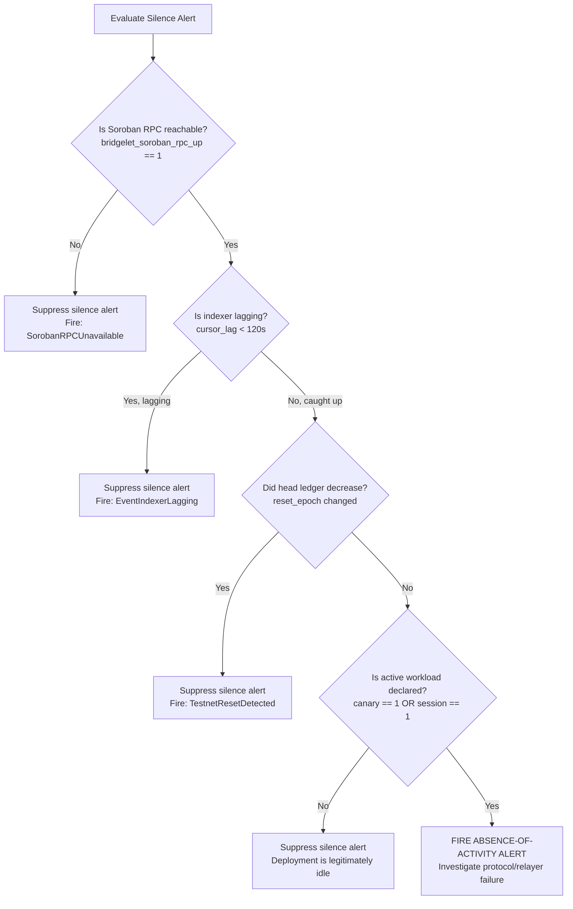

# Testnet Event Watchlist & Signals-of-Life Specification

## Status

> **Proposed event reference, signals-of-life baseline, and absence-of-activity alerting policy.**
> No scheduled event collector, automated dead-man alert, or synthetic canary is active
> in this repository today. This document specifies the authoritative on-chain events,
> defines their baseline frequencies during active testnet workloads, and establishes
> silence thresholds for automated absence-of-activity alerting.

This document identifies which on-chain events emitted by Bridgelet contracts on Stellar
Testnet serve as critical "signals of life", the conditions under which their absence
indicates an operational failure, and the diagnostic triage required when an alert fires.

---

## 1. Signals of Life Overview

In a smart-contract bridge architecture, transaction submissions and relayers can fail
silently: network timeouts, transaction malformation, out-of-gas errors, signature
mismatches, and nonce desynchronization often result in dropped transactions or local
exceptions that never produce on-chain reverts. 

On-chain contract events emitted into finalized Soroban ledgers provide immutable,
cryptographic proof that contract execution paths actually executed to completion.
Monitoring the presence and regular arrival of these events—and alerting on their
prolonged absence during active operations—acts as an essential dead-man switch for the
entire system.

### Event hierarchy

Events are categorized into three operational monitoring tiers:

| Tier | Classification | Events | Operational significance | Absence implication |
|---|---|---|---|---|
| **Tier 1** | **Critical Vital Signs** | `SweepCompleted` (`sweep`), `SweepExecutedMulti` (`swept_mul`), `AccountCreated` (`created`), `PaymentReceived` (`payment`) | Core value paths: account provisioning, payment logging, and fund sweeping. | Total system breakage: relayer halted, signature failure, gas exhaustion, or logic regression. |
| **Tier 2** | **Lifecycle & Recovery** | `AccountExpired` (`expired`), `ReserveReclaimed` (`reserve`), `MultiPaymentReceived` (`multi_pay`) | Secondary flows: time-based expiry recovery, reserve recycling, multi-token tracking. | Recovery failure: stuck expired accounts, trapped reserves, or multi-asset routing bugs. |
| **Tier 3** | **Configuration & Admin** | `DestinationAuthorized` (`dest_auth`), `DestinationUpdated` (`dest_upd`), `ContractInitialized` (`init`), `BaseReserveUpdated` (`reserve`) | Governance changes: destination locks, admin setup, reserve limits. | Sporadic events; absence is expected unless an administrative transaction was dispatched. |

---

## 2. Source of Truth & Topic Encoding

Soroban contract events contain an event symbol in `topics[0]`, optional indexed filter
topics, and a contracttype struct payload in `data`. Indexers must filter by both contract ID
and `topics[0]`.

The current source files in this repository are:
- `contracts/ephemeral_account/src/events.rs`
- `contracts/sweep_controller/src/lib.rs`
- `contracts/reserve_contract/src/events.rs`

> [!IMPORTANT]
> The Rust struct name is **not** the on-chain topic symbol. For instance,
> `PaymentReceived` is published under symbol `payment`, `SweepExecutedMulti` is
> published under `swept_mul`, and `SweepCompleted` is published under `sweep`.
> Indexers must subscribe to the short symbol, not the struct identifier.

### EphemeralAccount events

Contract ID: See [`../registry/contract-status.md`](../registry/contract-status.md)

| Topic `0` | Symbol | Rust payload struct | Emitted by | Lifecycle stage |
|---|---|---|---|---|
| `created` | `created` | `AccountCreated { creator, expiry_ledger }` | `initialize()` | Account creation |
| `payment` | `payment` | `PaymentReceived { amount, asset }` | First `record_payment()` | Deposit recording |
| `multi_pay` | `multi_pay` | `MultiPaymentReceived { asset, amount }` | Subsequent `record_payment()` | Multi-asset deposit |
| `swept_mul` | `swept_mul` | `SweepExecutedMulti { destination, payments }` | `sweep()` or `sweep_claim()` | Account terminal payout |
| `expired` | `expired` | `AccountExpired { recovery_address, amount_returned, reserve_amount }` | `expire()` or `recover()` | Account terminal recovery |
| `reserve` | `reserve` | `ReserveReclaimed { destination, amount, sweep_id, fully_reclaimed, remaining_reserve }` | Post-sweep/expire reserve return | Storage reserve reclaim |

### SweepController events

Contract ID: See [`../registry/contract-status.md`](../registry/contract-status.md)

| Topic `0` | Symbol | Rust payload struct | Emitted by | Lifecycle stage |
|---|---|---|---|---|
| `sweep` | `sweep` | `SweepCompleted { ephemeral_account, destination, amount }` | `execute_sweep()` or `claim()` | Controller sweep execution |
| `dest_auth` | `dest_auth` | `DestinationAuthorized { destination }` | `initialize()` with destination | Controller initialization |
| `dest_upd` | `dest_upd` | `DestinationUpdated { old_destination, new_destination }` | `set_destination()` | Admin configuration |

### ReserveContract events

Contract ID: See [`../registry/contract-status.md`](../registry/contract-status.md)

| Topic `0` | Symbol | Rust payload struct | Emitted by | Lifecycle stage |
|---|---|---|---|---|
| `init` | `init` | `ContractInitialized { admin }` | `initialize()` | Contract setup |
| `reserve` | `reserve` | `BaseReserveUpdated { old_value, new_value, admin }` | `set_base_reserve()` | Reserve configuration |

### AccountFactory events

The current `AccountFactory` source emits no direct events. A successfully instantiated
child account emits its own `created` event. Indexers must watch the resulting child
contract ID, not the factory address, for creation confirmation.

---

## 3. Operational Baselines & Expected Event Frequencies

A standing baseline of `> 0` events per minute across an arbitrary public testnet is
unrealistic during uninstrumented periods: an idle testnet legitimately has 0 events when
no user or bot transactions are sent. 

To enable reliable absence-of-activity alerting without false alarms, expected baseline
frequencies are coupled to **Operational Profiles**:



### Profile 1: Scheduled Synthetic Canary (Default Active Profile)

As specified in [`synthetic-transaction-plan.md`](synthetic-transaction-plan.md), an
automated end-to-end canary executes every **30 minutes**. Each canary run:
1. Deploys and initializes a new `EphemeralAccount` (`created`).
2. Transfers native XLM and calls `record_payment` (`payment`).
3. Obtains a signed authorization and executes `SweepController::execute_sweep`
   (`swept_mul` and `sweep`).

Under this profile, the expected baseline frequencies and absence thresholds are:

| Event symbol | Contract | Expected baseline (Canary active) | Silence threshold (Warning) | Silence threshold (Critical) | Severity |
|---|---|---|---:|---:|---|
| `sweep` | `SweepController` | 2 events / hour (1 per 30m) | 45 minutes (1 missed cycle) | 60 minutes (2 missed cycles) | **P1 - Critical** |
| `swept_mul` | `EphemeralAccount` | 2 events / hour (1 per 30m) | 45 minutes (1 missed cycle) | 60 minutes (2 missed cycles) | **P1 - Critical** |
| `payment` | `EphemeralAccount` | 2 events / hour (1 per 30m) | 45 minutes (1 missed cycle) | 60 minutes (2 missed cycles) | **P2 - High** |
| `created` | `EphemeralAccount` | 2 events / hour (1 per 30m) | 45 minutes (1 missed cycle) | 60 minutes (2 missed cycles) | **P2 - High** |

### Profile 2: Active Interactive Testing / CI Integration Runs

During scheduled documentation walkthroughs, developer demo rehearsals (e.g., using
`docs-walkthrough-01` from [`../registry/known-test-accounts.md`](../registry/known-test-accounts.md)),
or automated SDK integration test suite runs:

- **Workload pattern**: Batched bursts of account creations, payments, and sweeps.
- **Expected baseline**: 5 to 20 events per active hour across `created`, `payment`, and `sweep`.
- **Silence threshold**: **30 consecutive minutes** of zero events while the session flag
  `bridgelet_active_test_session == 1` is asserted.
- **Severity**: **P2 - High**.

### Profile 3: Expired Account Sweeper & Recovery Service

When accounts are provisioned with short testing expiry ledgers and a background sweeper
relayer is active to reclaim funds:

- **Workload pattern**: Periodic scan of accounts where `ledger >= expiry_ledger`.
- **Expected baseline**: At least 1 `expired` event per batch run whenever expired,
  unclaimed accounts exist in the account registry.
- **Silence threshold**: **2 hours** of silence when the number of overdue expired accounts
  is greater than zero (`overdue_expired_accounts_count > 0`).
- **Severity**: **P2 - High**.

### Profile 4: Dormant / Idle Testnet

When no synthetic canary is active and no testing session is flagged:
- **Baseline**: `0` events per hour.
- **Silence alert policy**: Absence-of-activity alerts are **gated and suppressed**. An idle
  network must never trigger pages for absence of organic user traffic.

---

## 4. Absence-of-Activity Failure Matrix: What a Missing Event Means

When events stop appearing during an active workload profile, on-call operators must
systematically isolate the failure layer. The table below documents the probable root causes
and diagnostic runbooks for each watched signal:

| Missing signal | Failure layer | Probable root causes | Immediate diagnostic verification | Runbook link |
|---|---|---|---|---|
| **`sweep`** / **`swept_mul`**<br>*(Canary or testing active)* | Relayer / Controller / Auth | 1. Relayer fee-payer balance below hard floor (`< 10 XLM`).<br>2. Signer nonce desynchronization in `SweepController`.<br>3. Invalid signature or key rotation mismatch.<br>4. Reentrancy guard stuck in `EphemeralAccount`.<br>5. SEP-41 token transfer revert (insufficient balance or frozen trustline). | `stellar contract invoke --id $CONTROLLER_ID -- get_nonce`<br>`stellar contract invoke --id $ACCOUNT_ID -- get_status`<br>Check relayer balance in Horizon. | [`../runbooks/failed-sweep-signature.md`](../runbooks/failed-sweep-signature.md)<br>[`../runbooks/nonce-desync.md`](../runbooks/nonce-desync.md)<br>[`../runbooks/relayer-submission-failures.md`](../runbooks/relayer-submission-failures.md)<br>[`balance-thresholds.md`](balance-thresholds.md) |
| **`payment`**<br>*(Canary or testing active)* | Ingestion / Payer / Contract | 1. Payer account out of XLM or below hard floor.<br>2. Friendbot rate-limiting (HTTP 429) stalling top-up.<br>3. Deposit watcher / payment relayer crashed or disconnected.<br>4. `record_payment` reverting due to invalid token address or zero amount. | Check payer balance on Horizon.<br>Inspect latest payment transaction hash in RPC.<br>Verify token address is native SAC (`CDLZFC3SYJYDZT7K67VZ75HPJVIEUVNIXF47ZG2FB2RMQQVU2HHGCYSC`). | [`balance-thresholds.md`](balance-thresholds.md)<br>[`../runbooks/rpc-outage.md`](../runbooks/rpc-outage.md)<br>[`../runbooks/event-not-appearing-in-horizon.md`](../runbooks/event-not-appearing-in-horizon.md) |
| **`created`**<br>*(Canary or testing active)* | Factory / Deployer | 1. Deployer account out of XLM (WASM instantiation requires high gas).<br>2. AccountFactory salt collision or batch failure.<br>3. Uninstalled WASM hash on testnet.<br>4. Network reset erased contract WASM. | `stellar contract install --wasm ...`<br>Check deployer balance.<br>Inspect factory invocation transaction result. | [`../runbooks/account-factory-batch-failure.md`](../runbooks/account-factory-batch-failure.md)<br>[`../runbooks/contract-not-found-error.md`](../runbooks/contract-not-found-error.md)<br>[`../reset/README.md`](../reset/README.md) |
| **`expired`**<br>*(Overdue accounts exist)* | Recovery Relayer | 1. Recovery bot stopped or crashing on unhandled exception.<br>2. Ledger sequence miscalculation (`current_ledger < expiry_ledger`).<br>3. `expire()` reverting due to reserve reclaim error.<br>4. Recovery address invalid or missing trustline. | `stellar contract invoke --id $ACCOUNT_ID -- get_info`<br>Compare `current_ledger` against `expiry_ledger`.<br>Simulate manual `expire()` call via CLI. | [`../runbooks/expired-account-recovery-check.md`](../runbooks/expired-account-recovery-check.md)<br>[`../runbooks/stuck-ephemeral-account.md`](../runbooks/stuck-ephemeral-account.md)<br>[`../runbooks/insufficient-reserve-errors.md`](../runbooks/insufficient-reserve-errors.md) |
| **`swept_mul` present but `sweep` absent** | Controller Cross-Call | 1. Direct call to `EphemeralAccount::sweep()` bypassed `SweepController`.<br>2. Relayer submitted sweep directly to child instead of controller entrypoint.<br>3. Controller contract ID mismatched in canary config. | Query events filtered by account contract ID vs controller contract ID.<br>Verify `CANARY_CONTROLLER_ID` configuration. | [`../tooling/event-tail-spec.md`](../tooling/event-tail-spec.md)<br>[`synthetic-transaction-plan.md`](synthetic-transaction-plan.md) |
| **`sweep` present but destination balance unchanged** | Token Transfer / SAC | 1. Event emitted in transaction that subsequently failed in outer scope.<br>2. Amount recorded does not match token transfer magnitude.<br>3. Asset address points to invalid SAC instance. | Query destination account balance via Horizon.<br>Fetch full transaction trace using `getTransaction`. | [`dashboards-plan.md`](dashboards-plan.md)<br>[`../runbooks/event-not-appearing-in-horizon.md`](../runbooks/event-not-appearing-in-horizon.md) |

---

## 5. Absence-of-Activity Alerting Specification (Dead-Man Watcher)

To implement automated alerting on absent events, a future telemetry collector should
expose the following Prometheus-compatible metrics and evaluation rules:

### Telemetry metrics

```text
# Timestamp of the most recently observed finalized event (Unix seconds)
bridgelet_event_last_seen_timestamp_seconds{network="testnet", contract="EphemeralAccount", topic="created"}
bridgelet_event_last_seen_timestamp_seconds{network="testnet", contract="EphemeralAccount", topic="payment"}
bridgelet_event_last_seen_timestamp_seconds{network="testnet", contract="EphemeralAccount", topic="swept_mul"}
bridgelet_event_last_seen_timestamp_seconds{network="testnet", contract="EphemeralAccount", topic="expired"}
bridgelet_event_last_seen_timestamp_seconds{network="testnet", contract="SweepController", topic="sweep"}

# Cumulative counter of events ingested
bridgelet_event_count_total{network="testnet", contract="SweepController", topic="sweep"}

# Workload operational mode flag (1 = active, 0 = dormant)
bridgelet_synthetic_canary_active{network="testnet"}
bridgelet_active_test_session{network="testnet"}

# Number of known accounts currently past their expiry_ledger but unexpired
bridgelet_overdue_expired_accounts_count{network="testnet"}

# Data pipeline health metrics (prerequisites for silence alerting)
bridgelet_indexer_cursor_lag_seconds{network="testnet"}
bridgelet_soroban_rpc_up{network="testnet"}
```

### Proposed alert evaluation rules

```yaml
groups:
  - name: testnet_event_silence_alerts
    rules:
      # P1: Sweep silence during active synthetic canary
      - alert: TestnetCanarySweepSilence
        expr: >
          (time() - bridgelet_event_last_seen_timestamp_seconds{topic="sweep"}) > 3600
          and bridgelet_synthetic_canary_active == 1
          and bridgelet_soroban_rpc_up == 1
          and bridgelet_indexer_cursor_lag_seconds < 120
        for: 5m
        labels:
          severity: critical
          tier: P1
        annotations:
          summary: "Testnet SweepCompleted silence: no sweep events for >60 minutes"
          description: "Synthetic canary is active but zero SweepCompleted events have been observed in 60m. Relayer may be halted, out of gas, or failing signature verification."
          runbook: "testnet/runbooks/failed-sweep-signature.md"

      # P2: Payment recording silence during active canary
      - alert: TestnetCanaryPaymentSilence
        expr: >
          (time() - bridgelet_event_last_seen_timestamp_seconds{topic="payment"}) > 3600
          and bridgelet_synthetic_canary_active == 1
          and bridgelet_soroban_rpc_up == 1
          and bridgelet_indexer_cursor_lag_seconds < 120
        for: 5m
        labels:
          severity: high
          tier: P2
        annotations:
          summary: "Testnet PaymentReceived silence: no payment events for >60 minutes"
          description: "Synthetic canary is active but zero PaymentReceived events have been recorded in 60m. Canary funder or payment recorder may be failing."
          runbook: "testnet/runbooks/rpc-outage.md"

      # P2: Account creation silence during active canary
      - alert: TestnetCanaryAccountCreationSilence
        expr: >
          (time() - bridgelet_event_last_seen_timestamp_seconds{topic="created"}) > 3600
          and bridgelet_synthetic_canary_active == 1
          and bridgelet_soroban_rpc_up == 1
          and bridgelet_indexer_cursor_lag_seconds < 120
        for: 5m
        labels:
          severity: high
          tier: P2
        annotations:
          summary: "Testnet AccountCreated silence: no account creation for >60 minutes"
          description: "Synthetic canary is active but zero AccountCreated events have been observed in 60m. Account factory or deployer fee-payer may be depleted."
          runbook: "testnet/runbooks/account-factory-batch-failure.md"

      # P2: Recovery silence when overdue accounts exist
      - alert: TestnetOverdueAccountRecoverySilence
        expr: >
          bridgelet_overdue_expired_accounts_count > 0
          and (time() - bridgelet_event_last_seen_timestamp_seconds{topic="expired"}) > 7200
          and bridgelet_soroban_rpc_up == 1
          and bridgelet_indexer_cursor_lag_seconds < 120
        for: 15m
        labels:
          severity: high
          tier: P2
        annotations:
          summary: "Testnet AccountExpired silence: overdue accounts exist but no recovery events for >2 hours"
          description: "One or more ephemeral accounts have exceeded their expiry_ledger but zero AccountExpired events have appeared in 2h. Recovery worker is stalled."
          runbook: "testnet/runbooks/expired-account-recovery-check.md"
```

---

## 6. Disambiguating Data Pipeline Failures from Protocol Silence

A dead-man silence alert is dangerous if it fires during a local ingestion outage: if the
monitoring indexer crashes or Soroban RPC is unreachable, the system would erroneously
page on-call engineers for a "protocol sweep failure".

Before triggering any event-absence alert, the evaluation engine **must** verify data pipeline
integrity:



### Suppression criteria

1. **RPC Outage**: If Soroban RPC returns HTTP 5xx, connection timeouts, or TLS errors,
   suppress event absence alerts. Fire `SorobanRPCUnavailable`.
2. **Indexer Lag**: If the indexer's processed cursor is more than 120 seconds (approx. 24
   ledgers) behind the network head, suppress event absence alerts. Fire `EventIndexerLagging`.
3. **Testnet Reset**: If the observed head ledger drops below the processed cursor, a network
   reset has occurred. Reset historical baselines, quarantine the cursor, and suppress alerts
   until contracts are redeployed. See [`../reset/README.md`](../reset/README.md).
4. **Declared Maintenance**: Silence alerts must be suppressible via an operational flag
   during deliberate upgrades or relayer maintenance.

---

## 7. State versus Event Failures

Do not infer failure solely from a missing event:
- **RPC timeout or contract-not-found**: Investigate RPC infrastructure and network status
  first (`rpc-outage.md`).
- **State changed but event absent**: Investigate the event ingestion cursor, topic filter,
  decoder, Soroban retention window, or deployed ABI differences. Confirm state via
  `get_status` or `get_info`.
- **Event present but state unchanged**: Investigate contract reversion in an outer transaction
  context, reentrancy rollback, or event spoofing.
- **Ledger sequence decreased**: A testnet reset occurred; discard cursors and begin reset
  epoch procedures.

---

## 8. Collector Record Schema & Deduplication

A normalized event record persisted by the ingestion pipeline must retain at least:

```json
{
  "network": "testnet",
  "reset_epoch": "testnet-2026-epoch-01",
  "contract_id": "CA3D5KRYM6CB7OWQ6TWYRR3Z4T7GNZLKERYNZLKE...",
  "topic_0": "sweep",
  "ledger": 1042500,
  "ledger_closed_at": "2026-11-23T16:00:00Z",
  "transaction_hash": "a4f89d9c8b7e6f5d4c3b2a10...",
  "event_index": 0,
  "data": {
    "ephemeral_account": "CC...",
    "destination": "GA...",
    "amount": "10000000"
  }
}
```

### Deduplication rule

Deduplicate incoming event streams using the 5-tuple:
```text
(reset_epoch, ledger, transaction_hash, contract_id, event_index)
```
Preserve raw event XDR for audit and incident reproduction, but never store secret keys,
signing seeds, or authorization credentials.

---

## 9. Units & Interpretation Rules

| Field | Unit | Interpretation rule |
|---|---|---|
| `expiry_ledger`, `sweep_id` | Stellar ledger sequence | Not Unix timestamps; compare against `getLatestLedger`. |
| `Payment.timestamp` | Unix epoch seconds | Ledger close time captured during `record_payment()`. |
| `PaymentReceived.amount` | Asset base units (`i128`) | Native XLM uses 7 decimal places (10,000,000 stroops = 1 XLM). SEP-41 tokens may differ. |
| `SweepCompleted.amount` | Raw sum (`i128`) | Sum of recorded payment units; **cannot** be treated as a unified fiat or single-token balance across multi-asset sweeps. |
| `AccountExpired.amount_returned` | Raw sum (`i128`) | Sum of recorded payment units returned to recovery address. |
| `ReserveReclaimed.amount` | Stroops (`i128`) | Base reserve XLM refunded to destination. |

---

## 10. Activation Checklist for Absence-of-Activity Monitoring

Absence-of-activity monitoring must not be marked active until the following prerequisites
are validated:

- [ ] **Contract ID allowlist verified**: Contract IDs in [`../registry/contract-status.md`](../registry/contract-status.md)
      are confirmed live on testnet via [`../registry/verify-contract-live.md`](../registry/verify-contract-live.md).
- [ ] **ABI and symbol validation**: Deployed WASM event topics match current source
      (`created`, `payment`, `swept_mul`, `expired`, `reserve`, `sweep`).
- [ ] **Canary runner deployed**: Synthetic canary is executing on a verified 30-minute schedule
      with dedicated fee-payer and relayer funding.
- [ ] **Telemetry pipeline configured**: Ingestion collector exports `bridgelet_event_last_seen_timestamp_seconds`
      and cursor lag metrics.
- [ ] **Suppression logic tested**: Alert evaluator correctly suppresses absence alerts when
      RPC is stopped or when cursor lag exceeds 120s.
- [ ] **Reset epoch handling**: Ingestion pipeline detects ledger regression and resets
      dead-man timers gracefully.
- [ ] **Notification route verified**: Test alerts for `TestnetCanarySweepSilence` reach
      non-production Slack/PagerDuty webhooks.

Until all checklist items are signed off, the operational status is:

```text
testnet_event_watchlist: proposed_specification
dead_man_alerting: not_configured
```

---

## 11. Related Documents

- [`../registry/event-topics.md`](../registry/event-topics.md) — Authoritative event topic reference
- [`alert-thresholds.md`](alert-thresholds.md) — Expiry-to-sweep ratio and zero-sweep diagnostic thresholds
- [`balance-thresholds.md`](balance-thresholds.md) — Minimum fee-payer balances and out-of-gas mitigation
- [`synthetic-transaction-plan.md`](synthetic-transaction-plan.md) — End-to-end synthetic canary specification
- [`dashboards-plan.md`](dashboards-plan.md) — Testnet monitoring dashboard layout and data sources
- [`uptime-check-spec.md`](uptime-check-spec.md) — Contract liveness and RPC reachability checks
- [`../runbooks/failed-sweep-signature.md`](../runbooks/failed-sweep-signature.md) — Triage for sweep failures
- [`../runbooks/event-not-appearing-in-horizon.md`](../runbooks/event-not-appearing-in-horizon.md) — Triage for missing events
- [`../runbooks/expired-account-recovery-check.md`](../runbooks/expired-account-recovery-check.md) — Recovery procedures
- [`../reset/README.md`](../reset/README.md) — Network reset handling and epoch management
