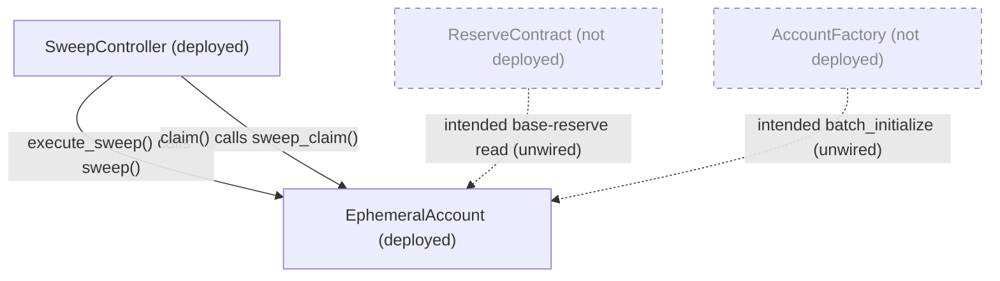

# Testnet Contract Dependency Graph

## Overview

This diagram shows the actual call relationships exercised on testnet today. Note that `ReserveContract` and `AccountFactory` are currently disconnected from this graph per their undeployed/unwired status.

## Current Live Topology (Testnet)

```
┌─────────────────────────────────────────────────────────────────────────────┐
│                         OFF-CHAIN SDK / RELAYER                             │
│  ┌─────────────────┐    ┌─────────────────┐    ┌─────────────────────────┐  │
│  │ Payment Watcher │    │ Signer/Relayer  │    │ Recipient (Claim)       │  │
│  │  (record_payment)│    │ (execute_sweep) │    │ (claim auth only)       │  │
│  └────────┬────────┘    └────────┬────────┘    └───────────┬─────────────┘  │
└───────────│──────────────────────│─────────────────────────│────────────────┘
            │                      │                         │
            ▼                      ▼                         ▼
┌─────────────────────────────────────────────────────────────────────────────┐
│                         STELLAR TESTNET                                     │
│                                                                             │
│  ┌──────────────────┐         ┌─────────────────────────┐                  │
│  │  EphemeralAccount │         │   SweepController      │                  │
│  │  (deployed)       │         │   (deployed)           │                  │
│  │                   │         │                         │                  │
│  │  initialize()     │◀─────── │  initialize()          │                  │
│  │  record_payment() │         │  execute_sweep()  ────▶│──── sweep()      │
│  │  sweep()          │         │       │                │     sweep_claim()│
│  │  sweep_claim()    │◀────────┘       │                │                  │
│  │  expire()         │                 ▼                │                  │
│  │  is_expired()     │         ┌───────────────┐        │                  │
│  │  get_info()       │         │ SEP-41 Tokens │◀───────┘                  │
│  │                   │         │ (transfers)   │        (transfer calls)   │
│  └──────────────────┘         └───────────────┘                          │
│                                                                             │
│  ┌──────────────────┐         ┌─────────────────────────┐                  │
│  │  ReserveContract  │         │   AccountFactory       │                  │
│  │  (NOT DEPLOYED)   │         │   (NOT DEPLOYED)       │                  │
│  │                   │         │                         │                  │
│  │  set_base_reserve │    ✗  │  batch_initialize()     │                  │
│  │  get_base_reserve │    ✗  │  (deploys N accounts)   │                  │
│  └──────────────────┘         └─────────────────────────┘                  │
│                                                                             │
└─────────────────────────────────────────────────────────────────────────────┘
```

## Call Flow Details

### 1. Account Creation
```
Creator → EphemeralAccount.initialize(creator, expiry, recovery, controller, admin)
        → Emits: AccountCreated
```

### 2. Payment Recording (Off-chain watcher)
```
SDK/Watcher → EphemeralAccount.record_payment(amount, asset)
            → Emits: PaymentReceived (first) or MultiPaymentReceived (subsequent)
```
**No auth required** - Any caller can record payments.

### 3. Sweep (Signed Path - Relayer)
```
Relayer → SweepController.execute_sweep(ephemeral_account, destination, auth_signature)
        → SweepController.verify_sweep_auth() [Ed25519 + nonce check]
        → SweepController.authorize_as_current_contract()
        → EphemeralAccount.sweep(destination, auth_signature) [controller.require_auth()]
        → SweepController.execute_transfers() [SEP-41 transfers]
        → Emits: SweepCompleted (controller), SweepExecutedMulti (account)
```

### 4. Sweep (Gas-Free Claim Path - Recipient + Relayer)
```
Recipient → Signs Soroban auth for claim(recipient, ephemeral_account)
Relayer   → Submits claim() tx (pays fees)
          → SweepController.claim(recipient, ephemeral_account)
          → recipient.require_auth()
          → SweepController.authorize_as_current_contract()
          → EphemeralAccount.sweep_claim(recipient) [controller.require_auth()]
          → SweepController.execute_transfers()
          → Emits: SweepCompleted
```

### 5. Expiration
```
Anyone → EphemeralAccount.expire()
       → (after expiry_ledger reached)
       → Emits: AccountExpired, ReserveReclaimed
```

### 6. Reserve Reclaim (Post-sweep/expiry)
```
Anyone → EphemeralAccount.reclaim_reserve()
       → Emits: ReserveReclaimed (per call until fully reclaimed)
```

## Disconnected Contracts

### ReserveContract ❌
- **Status**: Not deployed on testnet
- **Intended role**: Single source of truth for network base reserve
- **Current gap**: EphemeralAccount uses hardcoded `BASE_RESERVE_STROOPS = 1_000_000_000`
- **Wiring needed**: EphemeralAccount should call `ReserveContract.require_base_reserve()` instead of using constant

### AccountFactory ❌
- **Status**: Not deployed on testnet
- **Intended role**: Batch deploy N EphemeralAccount instances
- **Current gap**: Not built by `scripts/build.sh`, not in CI, not in deploy script
- **Call relationship**: `batch_initialize()` → deploys N accounts → calls `initialize()` on each
- **Auth**: Creator must authorize batch_initialize

## Event Flow for Indexers

```
EphemeralAccount Events:
  created         → Account created
  payment         → First payment received
  multi_pay       → Additional payment received
  swept_mul       → Sweep executed (all assets)
  expired         → Account expired
  reserve         → Reserve reclaimed (per call)

SweepController Events:
  sweep           → Sweep completed (aggregate)
  dest_auth       → Destination locked at init
  dest_upd        → Destination updated
```

## Future Topology (When All Deployed)

```
                    ┌──────────────────┐
                    │  AccountFactory  │
                    │  batch_initialize│
                    └────────┬─────────┘
                             │ deploys N×
                             ▼
                    ┌──────────────────┐
                    │ EphemeralAccount │  (N instances)
                    │  (per account)   │
                    └────────┬─────────┘
                             │ sweep/sweep_claim
                             ▼
                    ┌──────────────────┐
                    │ SweepController  │  (single, shared)
                    │                  │
                    └────────┬─────────┘
                             │ SEP-41 transfers
                             ▼
                    ┌──────────────────┐
                    │  Token Contracts │  (USDC, XLM, etc.)
                    └──────────────────┘

                    ┌──────────────────┐
                    │ ReserveContract  │  (config)
                    │                  │
                    └────────┬─────────┘
                             ▲
                             │ read base_reserve
                    ┌────────┴─────────┐
                    │ EphemeralAccount │  (all instances)
                    └──────────────────┘
```

## Verification Commands

```bash
# Verify EphemeralAccount → SweepController call path
stellar contract invoke \
  --id <SWEEP_CONTROLLER_ID> \
  --network testnet \
  --source testnet-healthcheck \
  -- \
  can_sweep \
  --ephemeral_account <EPHEMERAL_ACCOUNT_ID>

# Verify SweepController nonce (replay protection)
stellar contract invoke \
  --id <SWEEP_CONTROLLER_ID> \
  --network testnet \
  --source testnet-healthcheck \
  -- \
  get_nonce

# Verify EphemeralAccount state
stellar contract invoke \
  --id <EPHEMERAL_ACCOUNT_ID> \
  --network testnet \
  --source testnet-healthcheck \
  -- \
  get_info
```

---

## Version History

| Version | Date | Changes |
|---|---|---|
| 1.0 | 2026-09-24 | Initial dependency graph for testnet topology |

---

## Live Call Path Diagram (Issue #986 Addendum)

The diagram below is a compact restatement of the call relationships actually exercised on testnet today: the two entry points on `SweepController` (`execute_sweep()` and `claim()`) calling into `EphemeralAccount` (`sweep()` and `sweep_claim()` respectively). It intentionally leaves `ReserveContract` and `AccountFactory` out of the live path: per the README and `testnet/docs/overview.md` they are not deployed by `scripts/deploy-testnet.sh` and are not wired into `EphemeralAccount`, so they are drawn as dashed nodes with dashed links to mark them as disconnected.



ASCII fallback (`[X]` = live/deployed node, `(X)` = dashed/disconnected node, `- - ->` = unwired/intended link):

```
 [SweepController] -- execute_sweep() -> sweep() --------------> [EphemeralAccount]
                  \-- claim()         -> sweep_claim() --------> [EphemeralAccount]

 (ReserveContract) - - - intended base-reserve read (unwired) - - -> [EphemeralAccount]
 (AccountFactory)  - - - intended batch_initialize (unwired)  - - -> [EphemeralAccount]
```

Legend: solid nodes and solid arrows are live on testnet today and show caller-to-callee direction — `SweepController::execute_sweep` invokes `EphemeralAccount::sweep`, and `SweepController::claim` invokes `EphemeralAccount::sweep_claim`. Dashed nodes and dashed arrows mark `ReserveContract` and `AccountFactory` as disconnected from this graph because they are undeployed/unwired per the README and `testnet/docs/overview.md`; their links describe only intended future integrations, not calls that happen on-chain today.